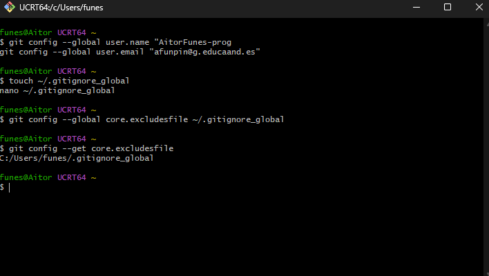
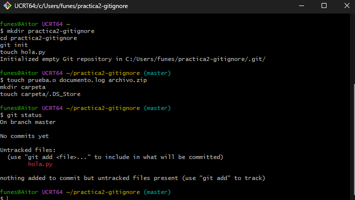
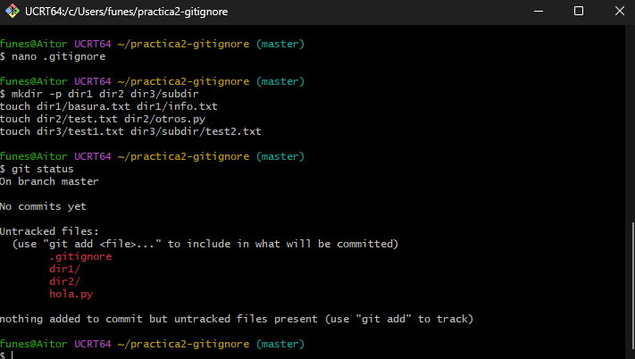

# Práctica 2: Uso avanzado de .gitignore y .gitignore_global

## 1. Configuración del archivo global
Primero, configuré el archivo global en mi directorio `$HOME` y lo vinculé a Git. Para comprobarlo, ejecuté el comando `git config --get core.excludesfile`.

## 2. Experimento con .gitignore_global
Creé varios archivos (`prueba.o`, `documento.log`, `archivo.zip` y `carpeta/.DS_Store`) en la raíz. Al ejecutar `git status`, comprobé que ninguno de estos archivos se mostraba como "Untracked". El archivo global los filtró automáticamente.

## 3. Experimento con .gitignore local
Creé el archivo `.gitignore` local con las siguientes reglas:
- `dir1/*` (Ignora todo en dir1)
- `!dir1/info.txt` (Excepción con el operador `!`: permite este archivo en concreto)
- `dir2/*.txt` (Ignora los txt en dir2)
- `dir3/**/*.txt` (Ignora los txt en dir3 y cualquier subnivel)

Al crear los archivos de prueba y ejecutar `git status`, verifiqué que `dir1/info.txt` y `dir2/otros.py` sí aparecían listos para añadir, mientras que el resto de `.txt` fueron completamente ignorados.

## 4. Diferencias entre ignorar de forma local y global
- **Global (`.gitignore_global`)**: Se aplica a **todos los repositorios** de la máquina del usuario. Es ideal para ignorar archivos generados por el sistema operativo (como `.DS_Store` en Mac o `Thumbs.db` en Windows) o archivos de tu IDE personal (como carpetas `.vscode`).
- **Local (`.gitignore`)**: Se aplica **solo al repositorio actual** y se comparte con el resto del equipo cuando se hace push. Sirve para ignorar archivos específicos del proyecto, como dependencias (`node_modules`), entornos virtuales, o archivos de configuración locales.
